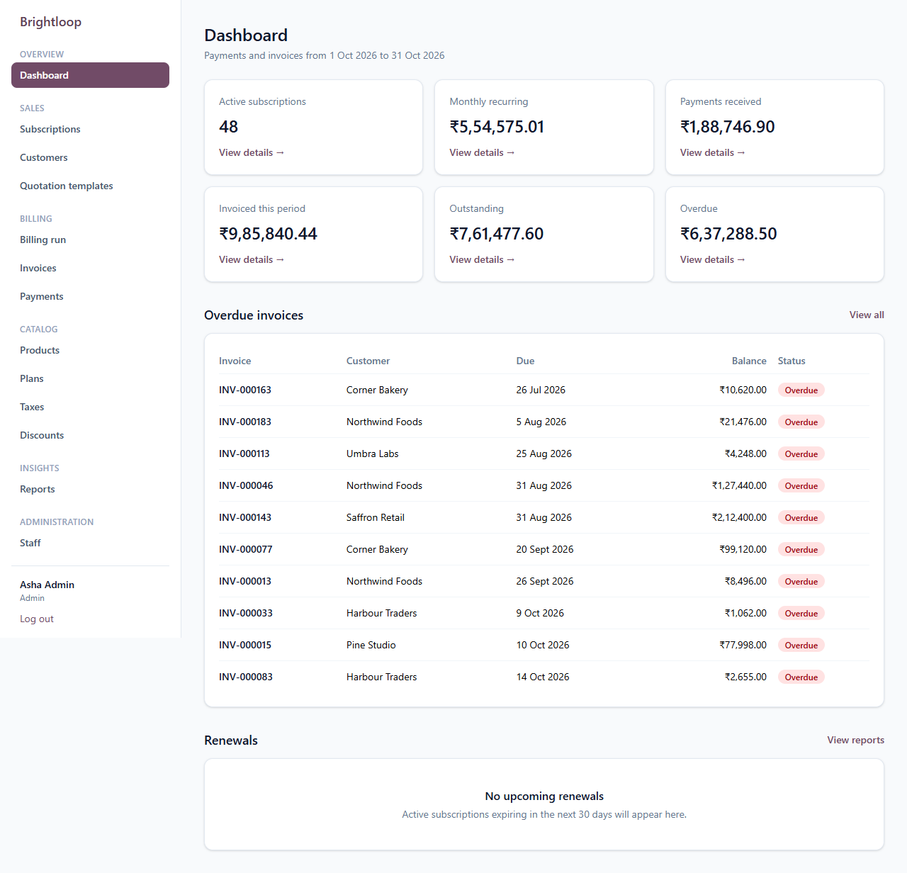
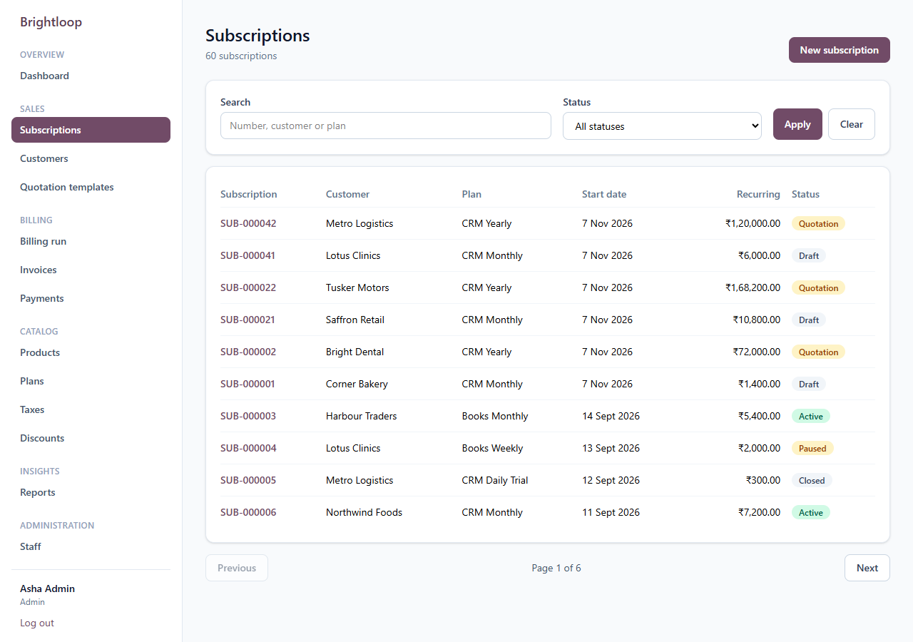
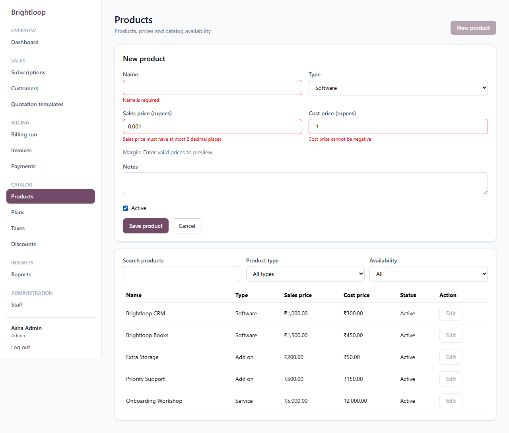
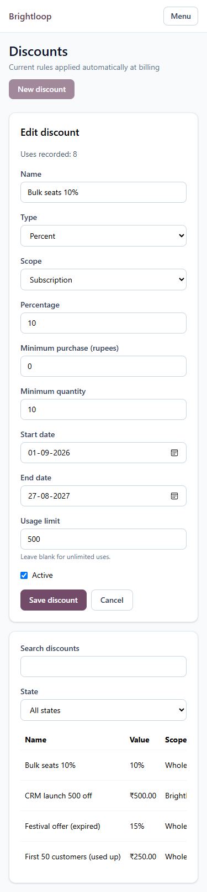

# Brightloop Subscriptions

> One system to run products, plans, subscriptions, recurring billing, payments and revenue reporting for a subscription business.

Built for the **Odoo x Make-A-Ton 9.0 Kochi Hackathon 2026** (virtual round, 31 October 2026).

## Problem statement

Brightloop Software earns its money every month, but runs on a spreadsheet: renewals get missed, invoices are typed by hand, payments are matched by reading bank statements, and nobody can say how much recurring revenue the company has. This system runs the whole subscription month in one place, from a new customer signing up to the finance lead's numbers. The full breakdown is in [docs/requirements.md](docs/requirements.md).

## Demo video

*Link added after submission.*

## Features

- Customers can create Customer-only accounts with password validation and atomic billing-profile linking (PS-1, PS-5).
- Staff can search, create and edit customers and inspect database-backed financial summaries (PS-12).
- Add customer-only subscription and invoice lists and details, scoped queries, URL search, payment history and balance display. (PS-26).
- Staff can record part and final payments from invoices with transactional balance protection (PS-21, PS-22).

- Startup/hourly processing activates due subscriptions, closes plans at expiry when configured, and generates due invoices (PS-14, PS-15).

- Staff can generate recurring Draft invoices with tax snapshots, catch-up billing and duplicate protection (PS-15, PS-16).

- Active accounts log in with expiring tokens and role-based navigation (PS-2).
- Add bounded per-IP attempt windows to login, forgot-password and reset-password without a new dependency. (PS-29).
- Staff can read paginated catalog data; Admins can create, edit and deactivate tax rules and payment terms (PS-10, PS-12).
- Admins can create, edit and deactivate products, with rupee inputs and margin calculation; staff can browse filtered product lists (PS-6).

- Admins manage quotation templates with validated lines; staff preview current plan, product and variant prices (PS-11).

- Admins configure plans with billing periods, sale dates, minimum quantities and subscription behaviour switches; staff can browse and filter plans (PS-8, PS-9).

- Add staff-only paginated payment search with combined method/date/text filters and invoice links. (PS-21).

- Add Admin-only staff search/create/edit with password validation, field conflicts and immediate deactivation. (PS-5).

- Add forgot/reset pages, 30-minute hashed recovery tokens and immediate session invalidation, including the same-second boundary. (PS-3).

- Admins manage fixed/percentage discounts, scope-specific products, minimums, dates and usage limits; staff filter current rule states (PS-19).

- Customers pause, resume and close their own subscriptions when the plan allows, with closing confirmation and server-side checks (PS-27).
- Customers accept their own unexpired quotations in the portal, with transaction-safe ownership and status checks (PS-27).

## Screenshots

**Finance dashboard:** recurring revenue, payments and overdue invoices (PS-23).



**Subscription workflow:** customer plans, lifecycle statuses and recurring amounts (PS-12, PS-13).



**Form validation:** required-name and invalid-price feedback before a product is saved (PS-6).



**Mobile view:** discount administration at 375 px (PS-19).



## Tech stack

| Layer | Technology |
|---|---|
| Frontend | React 19, Vite, React Router, Tailwind CSS v4 |
| Backend | Node.js, Express 5, organized into modules |
| Database | **PostgreSQL** (local) with the Prisma ORM |
| Validation | Zod on the server, with matching rules on the client |
| Auth | JWT and bcrypt |
| Live updates | Server-Sent Events |

Everything runs locally. There is no hosted database or backend service, and no third-party API in the core flow.

## Database

Database design is the heart of this project. [docs/data-model.md](docs/data-model.md) has the full documentation: the design decisions, ER diagram, every table and column, the check constraints that protect the data, and how each hard rule is guaranteed.

## Getting started

**Prerequisites:** Node.js 20.19 or later (or 22.12 or later), PostgreSQL 14 or later, and Git.

1. Clone the repository:

   ```bash
   git clone https://github.com/jasilmeledath/odoo-hackathon-2026.git
   ```

   ```bash
   cd odoo-hackathon-2026
   ```

2. Create the database:

   ```bash
   createdb brightloop_subscriptions
   ```

3. Set up the server:

   ```bash
   cd server
   ```

   ```bash
   cp .env.example .env
   ```

   Edit `server/.env`: set `DATABASE_URL` to your PostgreSQL user and password, and `JWT_SECRET` to a long random string.

   ```bash
   npm install
   ```

   ```bash
   npx prisma migrate deploy
   ```

   ```bash
   npm run db:generate
   ```

   ```bash
   npm run db:seed
   ```

4. Start the API on port 4000:

   ```bash
   npm run dev
   ```

5. In a second terminal, start the client from the repository root:

   ```bash
   cd client
   ```

   ```bash
   npm install
   ```

   ```bash
   npm run dev
   ```

6. Open [http://localhost:5173](http://localhost:5173).

Without SMTP settings in `server/.env`, emails such as password reset links are printed in the server terminal.

## Demo logins

Every account uses the password `Demo@12345`.

| Role | Email |
|---|---|
| Admin | `admin@demo.test` |
| Internal staff | `staff@demo.test` |
| Internal staff | `finance@demo.test` |
| Customer | `customer@demo.test` |
| Customer | `customer2@demo.test` |

## Project structure

```text
client/src/
  pages/<module>/      one folder of pages per module
  components/          shared UI
  lib/                 API client, auth, validators, formatters, hooks
server/
  prisma/              schema, migrations and seed data
  src/
    modules/<module>/  routes, service and schemas for each module
    middleware/        auth, validation, errors, request logging
    lib/               shared helpers
docs/                  requirements, plan, database, API and team standards
```

## Checks

From `server/`, run `npm test` for billing and catalog validation regressions.
The test runner uses the same tsx loader as the API for generated Prisma enums.
From `client/`, run `npm run build` to check the frontend.

### CI and local develop-to-main promotion

CI runs locally through Git hooks. Install the dependencies and enable the repository hooks once in each clone:

```bash
npm install
```

```bash
git config core.hooksPath .githooks
```

Set `server/.env` to a local PostgreSQL account that can create databases. With the hook enabled, feature-branch pushes run Prettier and the server tests; pushes to `develop` run the full gate. Any failed check stops the push, and direct pushes to `main` are blocked. To run the fast checks manually:

```bash
npm run ci:fast
```

From a clean, up-to-date `develop` branch, run the full gate manually without opening a PR:

```bash
npm run ci:local
```

To rerun the checks and create or locate the `develop`-to-`main` PR:

```bash
npm run promote:main
```

The full gate checks tracked source formatting, creates a disposable local database, applies migrations, runs `server` tests, and builds the client. It removes the temporary database afterward. `npm run promote:main` is the team process for promotion: it requires the current branch to be `develop`, a clean working tree, and local `develop` to match `origin/develop`; it then runs the full gate and opens the `develop`-to-`main` PR with the checked commit SHA in its description. Do not merge that PR unless the local promotion command passed for the same commit. The `gh` CLI must be installed and authenticated to create the PR.

## API

See [docs/api.md](docs/api.md).

## Known limitations

Current limitations (refreshed against develop `122148f`):

- Creating/editing subscriptions, lifecycle controls, discount management, customer portal reads and authentication attempt limits are now implemented.
- Starting a quotation from a template (#36), portal acceptance (#29), lifecycle actions (#31) and add-on changes (#32) still await their owners. Full demo and final sign-off remain open.
- The scale results in J-068 apply to its recorded source commit only. Newly merged screens require fresh measurements. PR #114 is merged, but its report is partial, so PS-25 remains in progress and issue #44 stays open.
- Without SMTP, invoice/recovery messages print locally. Real SMTP delivery has not been exercised. Authentication attempt counters are local to one API process and reset on restart.


## Team

| Name | GitHub | Owned |
|---|---|---|
| Jasil M (lead) | [@jasilmeledath](https://github.com/jasilmeledath) | Billing, invoices, database, integration |
| Yadhu Krishna P R | [@Yadh-Krishna](https://github.com/Yadh-Krishna) | Auth, staff, customers, payments, portal |
| Manoj PN | [@manojpnarayanan](https://github.com/manojpnarayanan) | Products, plans, taxes, discounts, templates |
| Jayasurya Suryadas | [@jsurya114](https://github.com/jsurya114) | Subscriptions, dashboard, reports |

## Contributing

Team rules are in [CONTRIBUTING.md](CONTRIBUTING.md) and [docs/engineering-standards.md](docs/engineering-standards.md). Tasks and the timeline are in [docs/implementation-plan.md](docs/implementation-plan.md).


### Database integration tests

Use a separately created, migrated and seeded local database. Set
`TEST_DATABASE_URL` to its PostgreSQL connection URL, then run from `server/`:

```bash
npm run test:integration
```

These tests create and remove their own fixture subscriptions and session-regression accounts. Do not point them
at production data. They exercise transactional billing, concurrent runs and password-session revocation.
