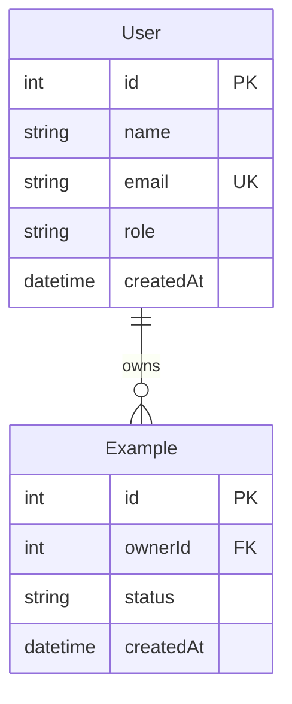

# Data Model

| Field | Value |
|---|---|
| Version | 0.1 |
| Owner | Whoever changes `server/prisma/schema.prisma` |
| Last updated | 29 October 2026 |
| Related documents | [Engineering Standards §7](engineering-standards.md#7-database) · [Naming Conventions](naming-conventions.md) |

`server/prisma/schema.prisma` is the source of truth. This page explains it for readers and is updated in the same commit as every migration.

## Entity relationship diagram

## Entities

| Entity | Purpose | Key rules |
|---|---|---|
| `User` | A person who logs in | Email unique; role is one of … |
| | | |

## Status values

| Entity | Field | Values and allowed transitions |
|---|---|---|
| | | |
