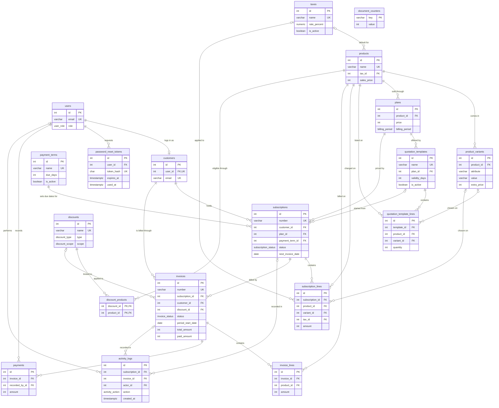
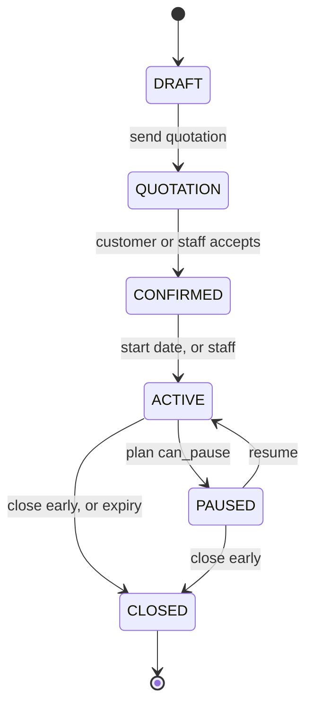
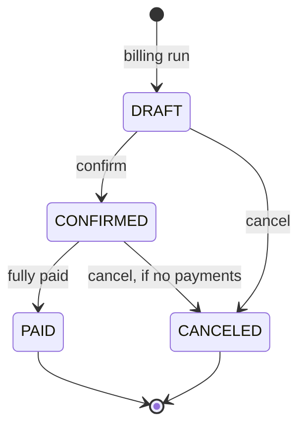

# Data Model and Database

| Field | Value |
|---|---|
| Version | 1.0 |
| Owner | Jasil M, and whoever changes `server/prisma/schema.prisma` |
| Last updated | 31 October 2026 |
| Related documents | [Requirements](requirements.md) · [Implementation Plan](implementation-plan.md) · [Engineering Standards §7](engineering-standards.md#7-database) · [Naming Conventions](naming-conventions.md) |

The complete database documentation: why it is designed this way, every table and column, every rule the database enforces, and how to set it up and change it.

`server/prisma/schema.prisma` and `server/prisma/migrations/` are the source of truth. This page is updated in the same commit as every migration. The tables in [§5](#5-table-by-table-reference) are generated from the running database, so their types, keys and checks match what is really there.

## Contents

1. [Database choice](#1-database-choice)
2. [Design principles](#2-design-principles)
3. [Entity relationship diagram](#3-entity-relationship-diagram)
4. [Enumerated types](#4-enumerated-types)
5. [Table-by-table reference](#5-table-by-table-reference)
6. [Lifecycles](#6-lifecycles)
7. [How the hard rules are guaranteed](#7-how-the-hard-rules-are-guaranteed)
8. [Normalization decisions](#8-normalization-decisions)
9. [Performance](#9-performance)
10. [Setup and day-to-day use](#10-setup-and-day-to-day-use)
11. [Useful queries](#11-useful-queries)
12. [Known limits](#12-known-limits)

---

## 1. Database choice

We use **PostgreSQL**, installed locally, accessed through the **Prisma ORM**. There is no hosted database or backend service (no Firebase, Supabase or MongoDB Atlas), so the app runs offline and no outside service can break it.

| Need in this problem | What PostgreSQL gives us |
|---|---|
| Strongly related records (customer → subscription → invoice → payment) | Foreign keys with explicit delete rules |
| "Nothing billed twice" | A partial unique index, which holds even if two billing runs overlap |
| Money that must add up | `CHECK` constraints, for example that an invoice's total equals subtotal minus discount plus tax |
| Fixed sets of values | Native `ENUM` types |
| Calendar dates versus moments in time | Separate `DATE` and `TIMESTAMPTZ` types |
| Billing several subscriptions safely at once | Transactions and row locks |
| Finance reports over thousands of rows | Indexes and fast `SUM` aggregates |

## 2. Design principles

1. **The database protects itself.** Validation in the app gives friendly messages, and the database is the final guard. A bug in application code cannot store an impossible record.
2. **Every relationship is a real foreign key** with a deliberate delete rule. Financial history uses `RESTRICT`, so it can never be deleted by accident. Records that have been used are deactivated with `is_active`, not deleted.
3. **One fact, one place.** Tables are in third normal form. The few copied values are deliberate and listed in [§8](#8-normalization-decisions).
4. **An issued invoice never changes.** Prices, taxes, names and addresses are copied onto it when it is created.
5. **Money is whole paise in `INTEGER` columns,** never a floating-point number. ₹1,560.00 is stored as `156000`. Integer sums are exact, and rounding happens once per line, in one helper. Rates and percentages use `NUMERIC(5,2)`.
6. **Dates use the right type.** `DATE` for calendar days (`due_date`), and `TIMESTAMPTZ` for moments (`created_at`). Business days follow IST.
7. **Text has limits.** Every text column is `VARCHAR(n)`, matching the validation limits.

**Naming.** Tables are plural snake_case (`subscription_lines`), and columns are snake_case. Foreign keys are `<entity>_id`, booleans start with `is_`, `can_` or a verb, dates end in `_date`, moments end in `_at`, and calculated money ends in `_amount`. Catalog prices keep the problem statement's word (`sales_price`, `unit_price`). Constraints are `<table>_<rule>_check`. Prisma maps these to `PascalCase` models and `camelCase` fields for the code.

## 3. Entity relationship diagram



## 4. Enumerated types

These are native PostgreSQL `ENUM` types, so a wrong value cannot be stored. Zod schemas read the same lists from the Prisma enums.

| Type | Values |
|---|---|
| `user_role` | `ADMIN`, `INTERNAL`, `CUSTOMER` |
| `product_type` | `SOFTWARE`, `ADD_ON`, `SERVICE` |
| `billing_period` | `DAILY`, `WEEKLY`, `MONTHLY`, `YEARLY` |
| `subscription_status` | `DRAFT`, `QUOTATION`, `CONFIRMED`, `ACTIVE`, `PAUSED`, `CLOSED` |
| `close_reason` | `EXPIRED`, `CLOSED_EARLY` |
| `invoice_status` | `DRAFT`, `CONFIRMED`, `PAID`, `CANCELED` |
| `discount_type` | `FIXED`, `PERCENT` |
| `discount_scope` | `PRODUCT`, `SUBSCRIPTION` |
| `payment_method` | `CASH`, `BANK_TRANSFER`, `UPI`, `CARD`, `CHEQUE` |
| `activity_action` | `CREATED`, `UPDATED`, `STATUS_CHANGED`, `RENEWED`, `PAUSED`, `RESUMED`, `CLOSED`, `INVOICED`, `SENT`, `CANCELED`, `PAYMENT_RECORDED` |

## 5. Table-by-table reference

Money columns are in paise. In the **Key** column, the word in brackets is what happens to this row when the referenced row is deleted.

### People and access

#### `users`

One row per login. Who may sign in lives here; who we bill lives in `customers`. Refs: PS-1, PS-2, PS-4, PS-5.

| Column | Type | Required | Default | Key |
|---|---|---|---|---|
| `id` | INTEGER | Yes | `auto` | PK |
| `name` | VARCHAR(120) | Yes |  |  |
| `email` | VARCHAR(254) | Yes |  | Unique |
| `password_hash` | VARCHAR(100) | Yes |  |  |
| `role` | `user_role` | Yes | `CUSTOMER` |  |
| `is_active` | BOOLEAN | Yes | `true` |  |
| `created_at` | TIMESTAMPTZ | Yes | `now` |  |
| `updated_at` | TIMESTAMPTZ | Yes |  |  |
| `password_changed_at` | TIMESTAMPTZ | No |  |  |

**Indexes:** `(role)`

**Checks:**

- `users_email_lowercase_check`: `(email) = lower((email))`

#### `password_reset_tokens`

Single-use reset links. Only the SHA-256 hash of the token is stored, so a leaked table cannot be used to reset passwords. Refs: PS-3.

| Column | Type | Required | Default | Key |
|---|---|---|---|---|
| `id` | INTEGER | Yes | `auto` | PK |
| `user_id` | INTEGER | Yes |  | FK → `users` (cascade) |
| `token_hash` | CHAR(64) | Yes |  | Unique |
| `expires_at` | TIMESTAMPTZ | Yes |  |  |
| `used_at` | TIMESTAMPTZ | No |  |  |
| `created_at` | TIMESTAMPTZ | Yes | `now` |  |

**Indexes:** `(user_id)`

#### `customers`

A business we bill. `user_id` is empty until the customer has a login, so a sales rep can quote a customer who has never signed up. Refs: PS-4, PS-12, PS-26.

| Column | Type | Required | Default | Key |
|---|---|---|---|---|
| `id` | INTEGER | Yes | `auto` | PK |
| `user_id` | INTEGER | No |  | FK → `users` (set null) · Unique |
| `name` | VARCHAR(120) | Yes |  |  |
| `company_name` | VARCHAR(160) | No |  |  |
| `email` | VARCHAR(254) | Yes |  | Unique |
| `phone` | VARCHAR(20) | No |  |  |
| `address` | VARCHAR(500) | No |  |  |
| `is_active` | BOOLEAN | Yes | `true` |  |
| `created_at` | TIMESTAMPTZ | Yes | `now` |  |
| `updated_at` | TIMESTAMPTZ | Yes |  |  |

**Indexes:** `(company_name)`

**Checks:**

- `customers_email_lowercase_check`: `(email) = lower((email))`

### Catalog

#### `taxes`

The tax rules set by the Admin. Refs: PS-10, PS-16.

| Column | Type | Required | Default | Key |
|---|---|---|---|---|
| `id` | INTEGER | Yes | `auto` | PK |
| `name` | VARCHAR(60) | Yes |  | Unique |
| `rate_percent` | NUMERIC(5,2) | Yes |  |  |
| `is_active` | BOOLEAN | Yes | `true` |  |
| `created_at` | TIMESTAMPTZ | Yes | `now` |  |
| `updated_at` | TIMESTAMPTZ | Yes |  |  |

**Checks:**

- `taxes_rate_percent_check`: `(rate_percent >= (0)) AND (rate_percent <= (100))`

#### `payment_terms`

How long a customer has to pay, for example Net 30. An invoice due date is its issue date plus `due_days`. Refs: PS-12.

| Column | Type | Required | Default | Key |
|---|---|---|---|---|
| `id` | INTEGER | Yes | `auto` | PK |
| `name` | VARCHAR(60) | Yes |  | Unique |
| `due_days` | INTEGER | Yes |  |  |
| `is_active` | BOOLEAN | Yes | `true` |  |
| `created_at` | TIMESTAMPTZ | Yes | `now` |  |
| `updated_at` | TIMESTAMPTZ | Yes |  |  |

**Checks:**

- `payment_terms_due_days_check`: `due_days >= 0`

#### `products`

What Brightloop sells. `tax_id` is the default tax copied to subscription lines. Refs: PS-6.

| Column | Type | Required | Default | Key |
|---|---|---|---|---|
| `id` | INTEGER | Yes | `auto` | PK |
| `name` | VARCHAR(120) | Yes |  | Unique |
| `type` | `product_type` | Yes |  |  |
| `sales_price` | INTEGER | Yes |  |  |
| `cost_price` | INTEGER | Yes |  |  |
| `notes` | VARCHAR(1000) | No |  |  |
| `tax_id` | INTEGER | No |  | FK → `taxes` (set null) |
| `is_active` | BOOLEAN | Yes | `true` |  |
| `created_at` | TIMESTAMPTZ | Yes | `now` |  |
| `updated_at` | TIMESTAMPTZ | Yes |  |  |

**Indexes:** `(tax_id)` · `(type, is_active)`

**Checks:**

- `products_prices_check`: `(sales_price >= 0) AND (cost_price >= 0)`

#### `product_variants`

A choice on a product, such as Brand: Odoo, with the amount it adds to the price. Refs: PS-7.

| Column | Type | Required | Default | Key |
|---|---|---|---|---|
| `id` | INTEGER | Yes | `auto` | PK |
| `product_id` | INTEGER | Yes |  | FK → `products` (cascade) |
| `attribute` | VARCHAR(60) | Yes |  |  |
| `value` | VARCHAR(60) | Yes |  |  |
| `extra_price` | INTEGER | Yes | `0` |  |
| `created_at` | TIMESTAMPTZ | Yes | `now` |  |
| `updated_at` | TIMESTAMPTZ | Yes |  |  |

**Indexes:** unique `(product_id, attribute, value)`

**Checks:**

- `product_variants_extra_price_check`: `extra_price >= 0`

The variant deletion service locks the variant row before checking
subscription references and deleting in one transaction (PS-7). This
application guard is needed because the existing nullable variant
foreign key uses SET NULL; the lock serializes new references with deletion.

#### `plans`

How one product is sold: price per period, billing period, minimum quantity, when it can be sold, and what may happen to subscriptions on it. Refs: PS-8, PS-9.

| Column | Type | Required | Default | Key |
|---|---|---|---|---|
| `id` | INTEGER | Yes | `auto` | PK |
| `name` | VARCHAR(120) | Yes |  | Unique |
| `product_id` | INTEGER | Yes |  | FK → `products` (restrict) |
| `price` | INTEGER | Yes |  |  |
| `billing_period` | `billing_period` | Yes |  |  |
| `min_quantity` | INTEGER | Yes | `1` |  |
| `start_date` | DATE | Yes |  |  |
| `end_date` | DATE | No |  |  |
| `closes_at_expiry` | BOOLEAN | Yes | `false` |  |
| `can_close_early` | BOOLEAN | Yes | `true` |  |
| `can_pause` | BOOLEAN | Yes | `false` |  |
| `can_renew` | BOOLEAN | Yes | `true` |  |
| `is_active` | BOOLEAN | Yes | `true` |  |
| `created_at` | TIMESTAMPTZ | Yes | `now` |  |
| `updated_at` | TIMESTAMPTZ | Yes |  |  |

**Indexes:** `(is_active, start_date, end_date)` · `(product_id)`

**Checks:**

- `plans_dates_check`: `(end_date IS NULL) OR (end_date >= start_date)`
- `plans_min_quantity_check`: `min_quantity >= 1`
- `plans_price_check`: `price >= 0`

### Quotations and subscriptions

#### `quotation_templates`

A ready-made offer: a plan and how many days a quotation stays valid. Refs: PS-11.

| Column | Type | Required | Default | Key |
|---|---|---|---|---|
| `id` | INTEGER | Yes | `auto` | PK |
| `name` | VARCHAR(120) | Yes |  | Unique |
| `plan_id` | INTEGER | Yes |  | FK → `plans` (restrict) |
| `validity_days` | INTEGER | Yes |  |  |
| `notes` | VARCHAR(1000) | No |  |  |
| `is_active` | BOOLEAN | Yes | `true` |  |
| `created_at` | TIMESTAMPTZ | Yes | `now` |  |
| `updated_at` | TIMESTAMPTZ | Yes |  |  |

**Indexes:** `(plan_id)`

**Checks:**

- `quotation_templates_validity_days_check`: `validity_days >= 1`

#### `quotation_template_lines`

The product lines of a template. No prices are stored, so a template never quotes an old price. Refs: PS-11.

| Column | Type | Required | Default | Key |
|---|---|---|---|---|
| `id` | INTEGER | Yes | `auto` | PK |
| `template_id` | INTEGER | Yes |  | FK → `quotation_templates` (cascade) |
| `product_id` | INTEGER | Yes |  | FK → `products` (restrict) |
| `variant_id` | INTEGER | No |  | FK → `product_variants` (set null) |
| `quantity` | INTEGER | Yes | `1` |  |

**Indexes:** `(product_id)` · `(template_id)` · `(variant_id)`

**Checks:**

- `quotation_template_lines_quantity_check`: `quantity >= 1`

#### `subscriptions`

The heart of the system: one customer on one plan, moving through its lifecycle. `next_invoice_date` is what drives billing. Refs: PS-12, PS-13, PS-14.

| Column | Type | Required | Default | Key |
|---|---|---|---|---|
| `id` | INTEGER | Yes | `auto` | PK |
| `number` | VARCHAR(20) | Yes |  | Unique |
| `customer_id` | INTEGER | Yes |  | FK → `customers` (restrict) |
| `plan_id` | INTEGER | Yes |  | FK → `plans` (restrict) |
| `template_id` | INTEGER | No |  | FK → `quotation_templates` (set null) |
| `payment_term_id` | INTEGER | Yes |  | FK → `payment_terms` (restrict) |
| `status` | `subscription_status` | Yes | `DRAFT` |  |
| `start_date` | DATE | Yes |  |  |
| `expiry_date` | DATE | Yes |  |  |
| `quotation_expiry_date` | DATE | No |  |  |
| `next_invoice_date` | DATE | No |  |  |
| `recurring_amount` | INTEGER | Yes | `0` |  |
| `monthly_recurring_amount` | INTEGER | Yes | `0` |  |
| `notes` | VARCHAR(1000) | No |  |  |
| `closed_at` | TIMESTAMPTZ | No |  |  |
| `close_reason` | `close_reason` | No |  |  |
| `created_at` | TIMESTAMPTZ | Yes | `now` |  |
| `updated_at` | TIMESTAMPTZ | Yes |  |  |

**Indexes:** `(customer_id, status)` · `(payment_term_id)` · `(plan_id)` · `(status, expiry_date)` · `(status, next_invoice_date)` · `(template_id)`

**Checks:**

- `subscriptions_amounts_check`: `(recurring_amount >= 0) AND (monthly_recurring_amount >= 0)`
- `subscriptions_closed_state_check`: `(status = 'CLOSED') = (closed_at IS NOT NULL)`
- `subscriptions_dates_check`: `expiry_date > start_date`

#### `subscription_lines`

What a subscription charges for each period. Refs: PS-12, PS-27.

| Column | Type | Required | Default | Key |
|---|---|---|---|---|
| `id` | INTEGER | Yes | `auto` | PK |
| `subscription_id` | INTEGER | Yes |  | FK → `subscriptions` (cascade) |
| `product_id` | INTEGER | Yes |  | FK → `products` (restrict) |
| `variant_id` | INTEGER | No |  | FK → `product_variants` (set null) |
| `tax_id` | INTEGER | No |  | FK → `taxes` (set null) |
| `quantity` | INTEGER | Yes |  |  |
| `unit_price` | INTEGER | Yes |  |  |
| `amount` | INTEGER | Yes |  |  |
| `is_active` | BOOLEAN | Yes | `true` |  |
| `created_at` | TIMESTAMPTZ | Yes | `now` |  |
| `updated_at` | TIMESTAMPTZ | Yes |  |  |

**Indexes:** `(product_id)` · `(subscription_id)` · `(tax_id)` · `(variant_id)`

**Checks:**

- `subscription_lines_amount_check`: `(unit_price >= 0) AND (amount = (quantity * unit_price))`
- `subscription_lines_quantity_check`: `quantity >= 1`

### Discounts

#### `discounts`

Discount rules. A rule is checked automatically at billing time. Refs: PS-19, PS-20.

| Column | Type | Required | Default | Key |
|---|---|---|---|---|
| `id` | INTEGER | Yes | `auto` | PK |
| `name` | VARCHAR(120) | Yes |  | Unique |
| `type` | `discount_type` | Yes |  |  |
| `fixed_amount` | INTEGER | No |  |  |
| `percent` | NUMERIC(5,2) | No |  |  |
| `scope` | `discount_scope` | Yes |  |  |
| `min_purchase_amount` | INTEGER | Yes | `0` |  |
| `min_quantity` | INTEGER | Yes | `0` |  |
| `start_date` | DATE | Yes |  |  |
| `end_date` | DATE | Yes |  |  |
| `usage_limit` | INTEGER | No |  |  |
| `usage_count` | INTEGER | Yes | `0` |  |
| `is_active` | BOOLEAN | Yes | `true` |  |
| `created_at` | TIMESTAMPTZ | Yes | `now` |  |
| `updated_at` | TIMESTAMPTZ | Yes |  |  |

**Indexes:** `(is_active, start_date, end_date)`

**Checks:**

- `discounts_dates_check`: `end_date >= start_date`
- `discounts_minimums_check`: `(min_purchase_amount >= 0) AND (min_quantity >= 0)`
- `discounts_usage_check`: `(usage_count >= 0) AND ((usage_limit IS NULL) OR ((usage_limit >= 1) AND (usage_count <= usage_limit)))`
- `discounts_value_check`: `((type = 'FIXED') AND (fixed_amount > 0) AND (percent IS NULL)) OR ((type = 'PERCENT') AND (percent > (0)) AND (percent <= (100)) AND (fixed_amount IS NULL))`

#### `discount_products`

The products a `PRODUCT`-scoped discount applies to. A junction table for a many-to-many relation. Refs: PS-19.

| Column | Type | Required | Default | Key |
|---|---|---|---|---|
| `discount_id` | INTEGER | Yes |  | PK · FK → `discounts` (cascade) |
| `product_id` | INTEGER | Yes |  | PK · FK → `products` (restrict) |

**Indexes:** `(product_id)`

### Billing

#### `invoices`

One bill for one period of one subscription. Refs: PS-15, PS-16, PS-17, PS-18, PS-22.

| Column | Type | Required | Default | Key |
|---|---|---|---|---|
| `id` | INTEGER | Yes | `auto` | PK |
| `number` | VARCHAR(20) | Yes |  | Unique |
| `subscription_id` | INTEGER | Yes |  | FK → `subscriptions` (restrict) |
| `customer_id` | INTEGER | Yes |  | FK → `customers` (restrict) |
| `discount_id` | INTEGER | No |  | FK → `discounts` (set null) |
| `status` | `invoice_status` | Yes | `DRAFT` |  |
| `billing_name` | VARCHAR(160) | Yes |  |  |
| `billing_address` | VARCHAR(500) | No |  |  |
| `issue_date` | DATE | Yes |  |  |
| `due_date` | DATE | Yes |  |  |
| `period_start_date` | DATE | Yes |  |  |
| `period_end_date` | DATE | Yes |  |  |
| `subtotal_amount` | INTEGER | Yes |  |  |
| `discount_amount` | INTEGER | Yes | `0` |  |
| `tax_amount` | INTEGER | Yes |  |  |
| `total_amount` | INTEGER | Yes |  |  |
| `paid_amount` | INTEGER | Yes | `0` |  |
| `sent_at` | TIMESTAMPTZ | No |  |  |
| `confirmed_at` | TIMESTAMPTZ | No |  |  |
| `paid_at` | TIMESTAMPTZ | No |  |  |
| `canceled_at` | TIMESTAMPTZ | No |  |  |
| `created_at` | TIMESTAMPTZ | Yes | `now` |  |
| `updated_at` | TIMESTAMPTZ | Yes |  |  |

**Indexes:** `(customer_id, status)` · `(discount_id)` · `(issue_date)` · unique `(subscription_id, period_start_date) WHERE (status <> 'CANCELED')` · `(status, due_date)` · `(subscription_id)`

**Checks:**

- `invoices_dates_check`: `(due_date >= issue_date) AND (period_end_date >= period_start_date)`
- `invoices_discount_amount_check`: `(discount_amount >= 0) AND (discount_amount <= subtotal_amount)`
- `invoices_paid_amount_check`: `(paid_amount >= 0) AND (paid_amount <= total_amount)`
- `invoices_paid_status_check`: `(status <> 'PAID') OR (paid_amount = total_amount)`
- `invoices_tax_amount_check`: `tax_amount >= 0`
- `invoices_total_amount_check`: `total_amount = ((subtotal_amount - discount_amount) + tax_amount)`

#### `invoice_lines`

A snapshot of each subscription line at billing time, so later price or tax changes never alter an issued invoice. Refs: PS-15, PS-16.

| Column | Type | Required | Default | Key |
|---|---|---|---|---|
| `id` | INTEGER | Yes | `auto` | PK |
| `invoice_id` | INTEGER | Yes |  | FK → `invoices` (cascade) |
| `product_id` | INTEGER | Yes |  | FK → `products` (restrict) |
| `description` | VARCHAR(200) | Yes |  |  |
| `quantity` | INTEGER | Yes |  |  |
| `unit_price` | INTEGER | Yes |  |  |
| `amount` | INTEGER | Yes |  |  |
| `discount_amount` | INTEGER | Yes | `0` |  |
| `tax_name` | VARCHAR(60) | No |  |  |
| `tax_rate_percent` | NUMERIC(5,2) | Yes | `0` |  |
| `tax_amount` | INTEGER | Yes | `0` |  |

**Indexes:** `(invoice_id)` · `(product_id)`

**Checks:**

- `invoice_lines_amount_check`: `(unit_price >= 0) AND (amount = (quantity * unit_price))`
- `invoice_lines_discount_amount_check`: `(discount_amount >= 0) AND (discount_amount <= amount)`
- `invoice_lines_quantity_check`: `quantity >= 1`
- `invoice_lines_tax_amount_check`: `tax_amount >= 0`

#### `payments`

Money received against one invoice. Payments are never edited or deleted. Refs: PS-21.

| Column | Type | Required | Default | Key |
|---|---|---|---|---|
| `id` | INTEGER | Yes | `auto` | PK |
| `invoice_id` | INTEGER | Yes |  | FK → `invoices` (restrict) |
| `recorded_by_id` | INTEGER | Yes |  | FK → `users` (restrict) |
| `method` | `payment_method` | Yes |  |  |
| `amount` | INTEGER | Yes |  |  |
| `payment_date` | DATE | Yes |  |  |
| `note` | VARCHAR(500) | No |  |  |
| `created_at` | TIMESTAMPTZ | Yes | `now` |  |

**Indexes:** `(invoice_id)` · `(payment_date)` · `(recorded_by_id)`

**Checks:**

- `payments_amount_check`: `amount > 0`

### Support

#### `activity_logs`

The timeline shown on subscription and invoice pages. `actor_id` is empty when the scheduler did the work. Refs: PS-13.

| Column | Type | Required | Default | Key |
|---|---|---|---|---|
| `id` | INTEGER | Yes | `auto` | PK |
| `subscription_id` | INTEGER | No |  | FK → `subscriptions` (cascade) |
| `invoice_id` | INTEGER | No |  | FK → `invoices` (cascade) |
| `actor_id` | INTEGER | No |  | FK → `users` (set null) |
| `action` | `activity_action` | Yes |  |  |
| `detail` | VARCHAR(500) | No |  |  |
| `created_at` | TIMESTAMPTZ | Yes | `now` |  |

**Indexes:** `(actor_id)` · `(invoice_id, created_at)` · `(subscription_id, created_at)`

**Checks:**

- `activity_logs_target_check`: `(subscription_id IS NOT NULL) OR (invoice_id IS NOT NULL)`

#### `document_counters`

The last number used for `SUB-` and `INV-` documents. Refs: PS-12, PS-15.

| Column | Type | Required | Default | Key |
|---|---|---|---|---|
| `key` | VARCHAR(30) | Yes |  | PK |
| `value` | INTEGER | Yes | `0` |  |

**Checks:**

- `document_counters_value_check`: `value >= 0`

## 6. Lifecycles

### Subscription



| Change | Allowed when | What else happens |
|---|---|---|
| Draft → Quotation | Has at least one line | Sets `quotation_expiry_date` from the template's `validity_days` |
| Quotation → Confirmed | The quotation has not expired | |
| Confirmed → Active | Staff act, or the start date arrives | Sets `next_invoice_date` to `start_date` |
| Active → Paused | `plans.can_pause` | Billing stops |
| Paused → Active | | `next_invoice_date` moves to the next period boundary on or after today, so paused time is not billed |
| Active or Paused → Closed, early | `plans.can_close_early` | `close_reason` is `CLOSED_EARLY`, and `next_invoice_date` is cleared |
| Active → Closed, at expiry | `plans.closes_at_expiry` | The daily job does this, with `close_reason` `EXPIRED` |
| Renew (stays Active) | `plans.can_renew` | `expiry_date` moves later |

Lines can be changed only in Draft and Quotation. After that, add-on lines can only be switched on or off with `is_active`, which takes effect on the next invoice.

### Invoice



**Overdue is not a status.** It means `status = 'CONFIRMED'` and `due_date` before today, worked out by the query, so it can never go stale.

## 7. How the hard rules are guaranteed

| Rule | Guarantee |
|---|---|
| **Nothing is billed twice** (PS-15) | The partial unique index `invoices_one_per_period_key` allows one non-canceled invoice for each subscription and period. If two billing runs overlap, the second fails with `P2002` and that subscription is skipped safely. |
| **Nothing is skipped** (PS-15) | `next_invoice_date` advances only in the same transaction that creates the invoice. If creation fails, the date stays where it was and the next run picks it up. Canceling an invoice moves the date back when needed (A-17). |
| **An invoice adds up** | `invoices_total_amount_check` requires total = subtotal − discount + tax. `invoice_lines_amount_check` requires amount = quantity × unit price. |
| **No overpayment** (A-14) | `invoices_paid_amount_check` keeps `paid_amount` between 0 and the total, even when two people record payments at the same moment. |
| **Paid means paid** | `invoices_paid_status_check` refuses `PAID` unless the full amount is in. |
| **One account per email** (PS-1) | A unique index on `users.email`, plus `users_email_lowercase_check`, so `A@x.com` and `a@x.com` cannot both exist. |
| **A discount cannot be overused** (PS-20) | `discounts_usage_check` keeps `usage_count` at or below `usage_limit`. |
| **Gapless document numbers** | `document_counters` is incremented inside the creating transaction. The row lock lasts until commit, and a rollback gives the number back. A plain database sequence would leave gaps, which accounting does not accept. |
| **Access ends at once** (PS-3, PS-4) | A login token holds the user id and an exact signed password version. Each request reads `role`, `is_active`, the customer link and `password_changed_at` from the database, and refuses a token whose password version differs. Password writes lock the user and advance the version even within the same millisecond. Demoting or deactivating someone, or resetting a password, applies immediately. |
| **History survives** | `RESTRICT` on customers, plans, products, subscriptions, invoices and payments. Deleting a customer who has invoices is refused. |
| **Issued invoices stay the same** | Billing name, address, descriptions, prices and tax rates are copied at creation. |

Prisma cannot express `CHECK` constraints or partial indexes, so they live in the migration `add_business_rule_constraints`. A check failure has no Prisma error code, so `server/src/middleware/error.js` matches PostgreSQL's code `23514` and returns `409`. Good validation should mean users never see it.

The migration `dashboard_change_notifications` adds statement-level triggers to `invoices` and `payments`. They call `pg_notify('dashboard_changed', ...)`; PostgreSQL delivers each notification only after the transaction commits. The server keeps one reconnecting `LISTEN` connection and forwards a payload-free `changed` event to authorized dashboard streams. This avoids polling financial tables and works across server processes.

We tested these directly against the database by trying to store a second invoice for a period, an overpayment, a wrong total, `PAID` without full payment, a negative price, a discount that was both fixed and percentage, an uppercase email and a zero payment, and by deleting a customer who has invoices. All were refused. Billing a canceled period again was allowed, and invoice numbers stayed gapless after a rollback.

## 8. Normalization decisions

Tables are in third normal form, and the values below are deliberately copied. Each one has a reason and a single place that keeps it right.

| Copied value | Why it is copied | What keeps it right |
|---|---|---|
| `invoices.customer_id` (also reachable through the subscription) | Portal and overdue lists need no join | Set once at creation. A subscription's customer does not change |
| `invoices.billing_name`, `billing_address` | A legal snapshot | Never updated |
| `invoice_lines` prices, tax name and rate | A legal snapshot | Never updated |
| `invoices.paid_amount` (the sum of its payments) | Outstanding and overdue lists stay fast at scale | An atomic increment in the transaction that inserts the payment, guarded by a check |
| `subscriptions.recurring_amount`, `monthly_recurring_amount` | Monthly recurring revenue is a fast `SUM` across thousands of rows | Recalculated whenever lines change, in `subscriptions.service.js` |
| `subscription_lines.amount`, `invoice_lines.amount` | Clear reads and reporting | Protected by a check constraint |

**Separate `users` and `customers`.** A login and a billed business are different things with different lifetimes (A-4). Splitting them keeps `password_hash` required, and keeps customer fields out of staff rows.

**Foreign keys on `activity_logs`.** A generic `entity_type` and `entity_id` pair cannot be protected by the database, so the table has two real nullable foreign keys and a check that at least one is set.

**Variants as attribute and value.** A variant stores its `attribute` and `value` as text on one table. That covers what the problem asks for without extra lookup tables.

## 9. Performance

PS-25 asks for every page in under two seconds with thousands of subscriptions.

- **Indexes** cover every foreign key and each filter column, using composite indexes in the order the queries filter, such as `(status, due_date)` and `(status, next_invoice_date)`.
- **Every list is paginated** at 50 rows at most, and selects only the columns it needs.
- **Totals are calculated by the database** with `SUM`, never by loading rows into JavaScript.
- **No N+1 queries:** related rows come through `include` or `select`.

Measured on PostgreSQL 15 on a laptop with 5,000 subscriptions, 20,004 invoices, 26,646 invoice lines and 14,686 payments. Times are the slowest of three runs, for the query alone:

| Query | Time |
|---|---|
| Dashboard summary (five aggregates together) | 5 ms |
| Overdue invoices, first page | 2 ms |
| Subscription search across number and company | 3 ms |
| Subscriptions due for billing | 1 ms |

At commit `466720a`, page routes were opened in Chrome against a local
PostgreSQL fixture seeded with 5,000 subscriptions. Starting the API also runs
the scheduler, which caught up due billing periods; when page timing began,
the database had 22,654 invoices, 30,204 invoice lines and 14,686 payments.
The browser measured navigation through a rendered accessibility snapshot
with warm static assets. These are local development observations, not cold
cache or production network results. The 23 implemented routes in that
revision completed in 113–201 ms. Discounts and the customer portal list
routes were placeholders in that revision and are excluded. The measurement
did not wait for each authenticated route's successful API response and
populated or valid empty state, so these figures are partial coverage and do
not verify PS-25:

| Page route | Time |
|---|---:|
| Dashboard | 201 ms |
| Login | 159 ms |
| Sign-up | 138 ms |
| Forgot password | 135 ms |
| Reset password | 113 ms |
| Customer list / create / detail / edit | 142 / 143 / 146 / 119 ms |
| Subscription list / create / detail / edit | 146 / 152 / 197 / 150 ms |
| Billing queue | 173 ms |
| Invoice list / detail | 148 / 163 ms |
| Payments | 173 ms |
| Products | 128 ms |
| Plans | 135 ms |
| Taxes | 153 ms |
| Quotation templates | 125 ms |
| Reports | 159 ms |
| Staff | 118 ms |

The same fixture's billing run processed 4,000 due active subscriptions in
9.8 seconds (3,169 invoices created, 831 skipped, 0 failed). The disposable
fixture's `next_invoice_date` values were set to the current date to exercise
the queue; the run was not executed against shared data. This throughput
observation is separate from the incomplete page readiness measurements.

To check a slow query, run it with `EXPLAIN ANALYZE` and look for a sequential scan on a large table.

## 10. Setup and day-to-day use

**Install PostgreSQL** (version 14 or later) on your machine, then create the database:

```bash
createdb brightloop_subscriptions
```

On macOS with Homebrew, install it with `brew install postgresql@15` and start it with `brew services start postgresql@15`. On Windows, use the installer from postgresql.org and create the database with pgAdmin.

**First run:**

```bash
cd server
```

```bash
cp .env.example .env
```

Edit `server/.env`: set `DATABASE_URL` to your own PostgreSQL user and password, and `JWT_SECRET` to a long random string.

```bash
npm install
```

```bash
npx prisma migrate deploy
```

```bash
npm run db:generate
```

```bash
npm run db:seed
```

| Task | Command (in `server/`) |
|---|---|
| Apply teammates' migrations after pulling | `npx prisma migrate dev`, then `npm run db:generate` |
| Change the schema | Edit `schema.prisma`, then `npx prisma migrate dev --name <what_changed>` and `npm run db:generate` |
| Add a check constraint or partial index | `npx prisma migrate dev --create-only --name <what_changed>`, add the SQL, then run `npx prisma migrate dev` and `npm run db:generate` |
| Reset to fresh demo data | `npm run db:reset` |
| Test at scale | `SEED_SUBSCRIPTIONS=5000 npm run db:seed` |
| Browse the data | `npx prisma studio` |

**Rules for changing the schema:** only one person changes `schema.prisma` at a time, so say so on the team chat first. Never edit a migration that is already on `main`. Update this page in the same commit.

**Seed data** covers every role and status: 3 staff logins, 2 customer logins, 26 customers, 5 products, 5 plans, 4 discounts (including an expired and a used-up one), 3 taxes, 4 payment terms, 60 subscriptions, and invoices in every state. A quarter of the running subscriptions are due today, so billing always has work to show. Logins are listed in the [README](../README.md#demo-logins).

## 11. Useful queries

Amounts owed and overdue, the same logic as the dashboard:

```sql
SELECT count(*) AS overdue_invoices,
       sum(total_amount - paid_amount) / 100.0 AS overdue_rupees
FROM invoices
WHERE status = 'CONFIRMED' AND due_date < CURRENT_DATE;
```

Monthly recurring revenue:

```sql
SELECT sum(monthly_recurring_amount) / 100.0 AS monthly_recurring_rupees
FROM subscriptions
WHERE status = 'ACTIVE';
```

Subscriptions waiting to be billed:

```sql
SELECT number, next_invoice_date
FROM subscriptions
WHERE status = 'ACTIVE' AND next_invoice_date <= CURRENT_DATE
ORDER BY next_invoice_date;
```

Check that every invoice's `paid_amount` matches its payments (this should return no rows):

```sql
SELECT i.number, i.paid_amount, coalesce(sum(p.amount), 0) AS payments
FROM invoices i
LEFT JOIN payments p ON p.invoice_id = i.id
GROUP BY i.id
HAVING i.paid_amount <> coalesce(sum(p.amount), 0);
```

## 12. Known limits

| Limit | Detail | How we would lift it |
|---|---|---|
| Largest amount in one value | `INTEGER` stores up to about ₹2.1 crore. Validation caps inputs at ₹1 crore. Totals in reports use `SUM`, which is not limited | Change the money columns to `BIGINT` |
| One tax per line | A-8 | Add a line-to-tax junction table |
| One discount per invoice | A-11 | Add an invoice-to-discount junction table |
| One currency | A-23 | Add a currency column to subscriptions and invoices |
